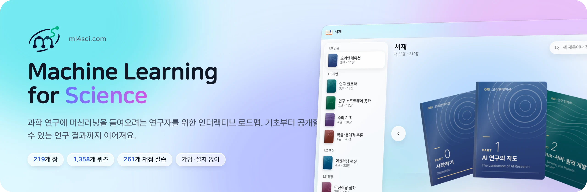
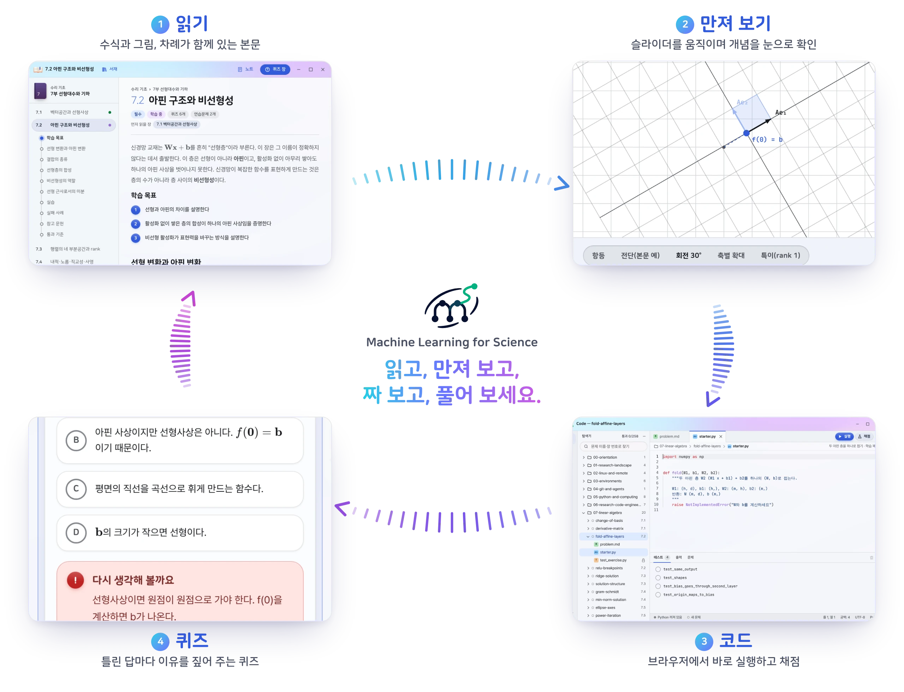
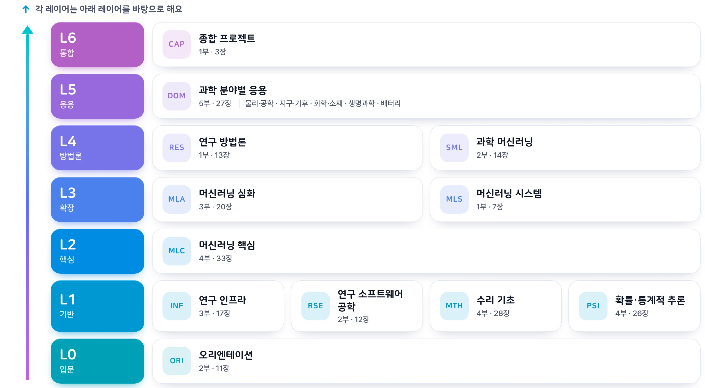
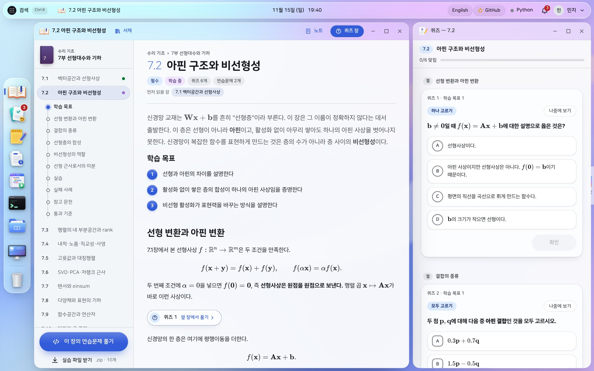
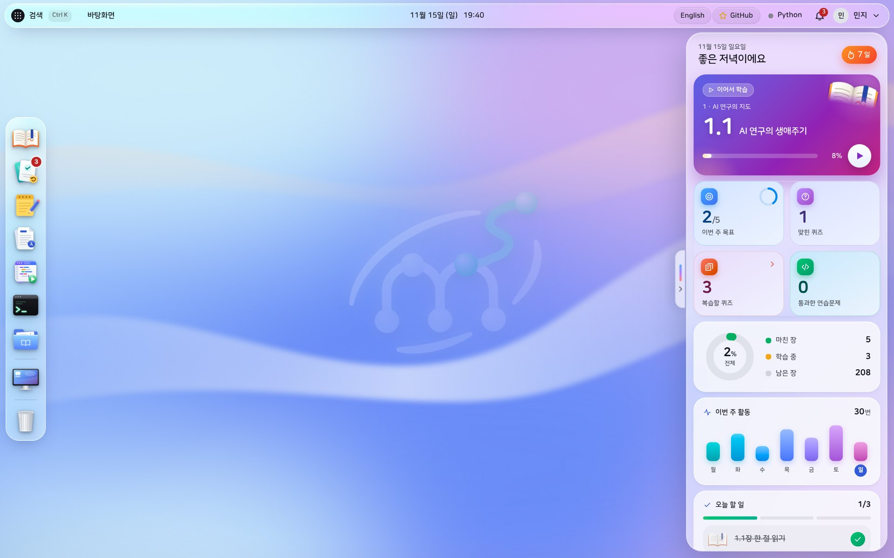
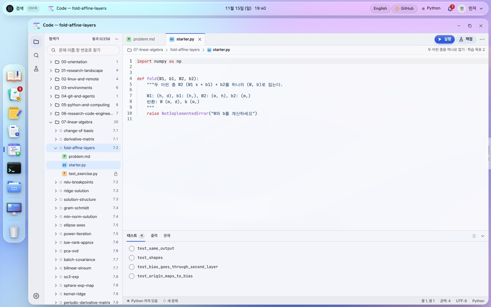
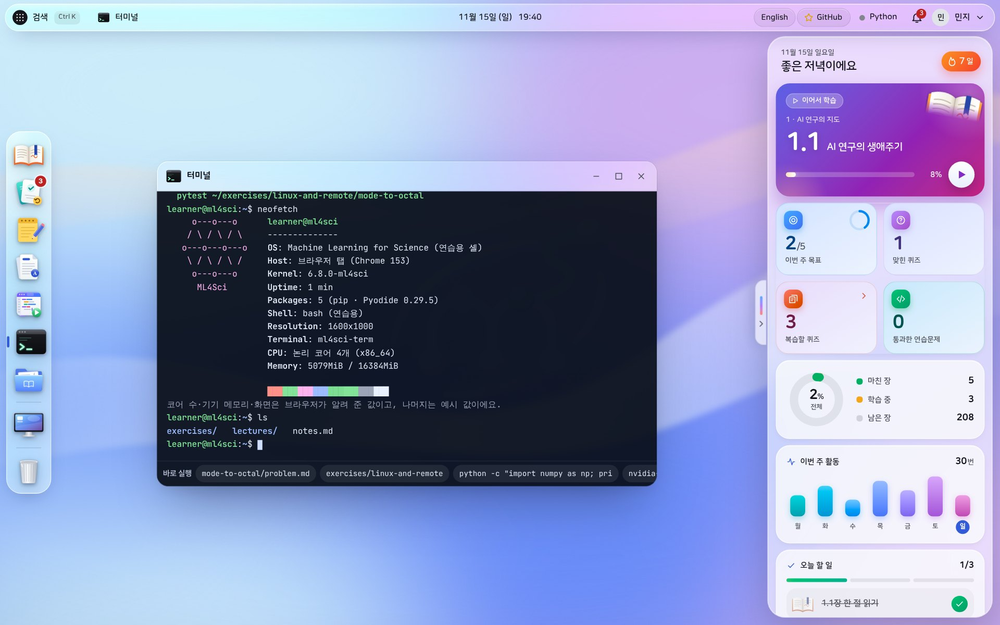

<a href="https://ml4sci.com">
  <picture>
    <source media="(prefers-color-scheme: dark)" srcset=".github/assets/ko/banner-dark.webp">
    
  </picture>
</a>

[English](README.md) | **한국어**

  
  
  
  
   
  
  
  
  
  

  <a href="https://ml4sci.com"><b>바로 읽기</b></a> ·
  <a href="#-공부하는-흐름">공부하는 흐름</a> ·
  <a href="#-특징">특징</a> ·
  <a href="#-커리큘럼">커리큘럼</a> ·
  <a href="#-자주-묻는-질문">자주 묻는 질문</a> ·
  <a href="https://github.com/pjmbatman/ml4sci/issues/new/choose">의견 보내기</a>

**Machine Learning for Science**([ml4sci.com](https://ml4sci.com))는 연구에 머신러닝을 써 보고 싶은 **과학자와 엔지니어**, 그리고 실제 과학 문제를 풀고 싶은 **AI 연구자**를 위한 인터랙티브 디지털 책이에요. 본문을 읽고, 그림을 직접 움직여 보고, Python 코드를 짜서 채점까지 모두 브라우저에서 해요. 설치할 것도, 만들 계정도 없어요.

  

> [!NOTE]
> 한국어판은 [ml4sci.com](https://ml4sci.com), 영어판은 [ml4sci.com/en](https://ml4sci.com/en/)에서 읽을 수 있어요. 한국어 원고가 원본이고, 영어판은 모든 장과 퀴즈, 연습문제를 옮긴 완역본이에요.

## 🔁 공부하는 흐름

모든 장은 같은 흐름으로 이어져요. 개념을 읽고, 손으로 만져 보고, 코드로 직접 짜 보고, 정말 이해했는지 퀴즈로 확인해요.

  <picture>
    <source media="(prefers-color-scheme: dark)" srcset=".github/assets/ko/loop-dark.webp">
    
  </picture>

| 단계 | 하는 일 | 책에서는 |
|---|---|---|
| **1&nbsp;·&nbsp;읽기** | 수식과 그림이 함께 있는 본문을 읽어요. 차례가 지금 읽는 곳을 따라와요. | `학습 목표 → 개념 → 실습 → 실패 사례 → 통과 기준` |
| **2&nbsp;·&nbsp;만져&nbsp;보기** | 슬라이더와 실시간 그래프로 증명을 읽기 전에 먼저 감을 잡아요. | 본문 곳곳의 인터랙티브 그림 |
| **3&nbsp;·&nbsp;코드** | 내장 편집기에서 Python을 짜고 *채점*을 누르면 테스트마다 통과 여부가 나와요. | 연습문제 258개, [Pyodide](https://pyodide.org)로 실행 |
| **4&nbsp;·&nbsp;퀴즈** | 틀린 답마다 어떤 오해에서 나왔는지 짚어 주고, 틀린 문제는 복습 목록으로 다시 돌아와요. | 퀴즈 1,315문항과 복습 대기열 |

## ✨ 특징

| | |
|---|---|
| 🧭 **장 모음이 아니라 로드맵** | 7단계 레이어에 12개 분야, 33부, 216개 장이 놓여 있어요. 장마다 먼저 읽을 장이 정해져 있어서 다음에 뭘 읽을지 늘 알 수 있어요. |
| 🐍 **브라우저에서 돌아가는 Python** | 코드 셀이 그 자리에서 Pyodide로 실행돼요(NumPy, SciPy, pandas, matplotlib, scikit-learn). PyTorch와 GPU 예제는 복사 단추와 함께 읽기 전용으로 보여 주고, 장마다 내려받는 실습 파일로 내 컴퓨터에서 돌려 볼 수 있어요. |
| ✅ **자동 채점 연습문제** | 내장 코드 편집기에 *실행*과 *채점* 단추가 있고, 테스트마다 결과를 보여 줘요. 장의 실습 파일은 `.zip`으로도 받을 수 있어요. |
| 🧠 **이유까지 알려 주는 퀴즈** | 틀린 답마다 그 밑에 깔린 오해를 설명해 주고, 틀린 문제는 복습 목록에 모여요. |
| 📚 **3D 서재** | 33권의 책을 분야별로 부채꼴로 펼쳐 놓았어요. 끌어서 돌리며 고르고, 책마다 내 진도가 보여요. |
| 🖥️ **공부용 데스크톱** | 강의, 복습, 노트, 문서, 코드 편집기, 터미널, 파일 탐색기를 창으로 나란히 띄워요. 대시보드에서 진도와 오늘 할 일을 한눈에 봐요. |
| 🔒 **처음부터 개인정보 보호** | 로그인이 없어요. 진도는 내 브라우저에만 저장되고, 파일로 내보냈다가 다시 가져올 수 있어요. |

## 🧭 커리큘럼

12개 분야가 7단계 레이어로 쌓여 있어요. 각 분야는 같은 레이어나 그보다 아래 레이어의 분야에만 기대고, 이 규칙은 모든 장의 선수 지식에 대해 자동으로 검사해요.

  <picture>
    <source media="(prefers-color-scheme: dark)" srcset=".github/assets/ko/curriculum-dark.webp">
    
  </picture>

<b>분야별 핵심 질문</b>

 

| 레이어 | 분야 | 핵심 질문 |
|---|---|---|
| **L0 입문** | 오리엔테이션 | AI 연구란 무엇이고, AI for Science는 어떤 지형인가? |
| **L1 기반** | 연구 인프라 | 코드는 어디에서, 어떤 환경으로 실행되는가? |
| | 연구 소프트웨어 공학 | 수식과 아이디어를 어떻게 정확하고 관리하기 쉬운 코드로 옮기는가? |
| | 수리 기초 | 모델은 어떤 공간에서, 어떤 계산으로 학습하는가? |
| | 확률·통계적 추론 | 불확실한 데이터에서 무엇을 얼마나 확신하며 추론할 수 있는가? |
| **L2 핵심** | 머신러닝 핵심 | 믿을 수 있는 예측 모델을 어떻게 만들고 평가하는가? |
| **L3 확장** | 머신러닝 심화 | 분포를 생성하고, 결정을 학습하고, 예측을 언제 믿어야 하는지 어떻게 아는가? |
| | 머신러닝 시스템 | 실험을 어떻게 기록하고, 재현하고, 키우는가? |
| **L4 방법론** | 연구 방법론 | 좋은 연구 질문은 무엇이고, 주장을 어떻게 검증하고 전달하는가? |
| | 과학 머신러닝 | 물리 법칙, 시뮬레이션, 실험을 학습과 어떻게 결합하는가? |
| **L5 응용** | 과학 분야별 응용 | 물리·공학 시뮬레이션 · 지구·기후 · 화학·소재 · 생명과학 · 에너지·배터리 |
| **L6 통합** | 종합 프로젝트 | 배운 것을 하나의 공개 가능한 연구 산출물로 만들 수 있는가? |

## 🖼️ 화면

  
   <b>서재</b>: 왼쪽에서 분야를 고르고, 부채꼴을 돌려 책을 펼쳐요.

  
   <b>강의</b>: 차례가 있는 본문과 그 옆의 퀴즈 창.

<table>
  <tr>
    <td width="50%"></td>
    <td width="50%"></td>
  </tr>
  <tr>
    <td align="center"><b>로그인</b>: 이름만 정하면 시작해요. 계정은 필요 없어요.</td>
    <td align="center"><b>데스크톱</b>: 독에는 앱, 대시보드에는 진도.</td>
  </tr>
  <tr>
    <td width="50%"></td>
    <td width="50%"></td>
  </tr>
  <tr>
    <td align="center"><b>코드 편집기</b>: 시작 코드와 테스트, 실행과 채점.</td>
    <td align="center"><b>터미널</b>: 브라우저 안에서 진짜 Python이 도는 연습용 셸.</td>
  </tr>
</table>

## 🚀 시작하기

1. 데스크톱 브라우저에서 **[ml4sci.com](https://ml4sci.com)**(한국어)이나 **[ml4sci.com/en](https://ml4sci.com/en/)**(영어)을 열어요. 휴대폰 화면도 지원해요. 언어는 로그인 화면이나 상단 바의 단추로 언제든 바꿀 수 있어요.
2. 표시할 이름을 입력하거나 **게스트**로 들어가요. 이름은 내 브라우저에만 남고, 계정이 아니에요.
3. 처음 들어오면 짧은 안내가 데스크톱을 소개해요. 사용자 메뉴의 *시작 가이드*에서 언제든 다시 볼 수 있고, 오른쪽 대시보드가 이어서 읽을 곳을 늘 알려 줘요.

## 📈 진행 상황

**1.0 버전이 한국어와 영어로 공개돼 있어요.** 216개 장, 퀴즈 1,315문항, 자동 채점 연습문제 258개를 두 언어 모두에서 볼 수 있어요. 책은 계속 다듬고 있어요. 장마다 검토하고 고치며, 제보받은 오류는 그 자리에서 바로잡아요.

## ❓ 자주 묻는 질문

<strong>누구를 위한 책인가요? 어떤 배경이 필요한가요?</strong>

 
연구에 머신러닝을 써 보려는 과학자·공학자, 과학 문제를 풀고 싶은 AI 연구자, 그리고 학부·대학원 입문자를 위한 책이에요. 학부 고학년 수준의 수학과 약간의 프로그래밍 경험이 있으면 편하게 따라올 수 있어요. 부족한 부분이 있어도 괜찮아요. 수학 기초와 Python, 서버·Git 같은 작업 환경도 책 안에서 다뤄요.

<strong>어디서부터 읽으면 되나요?</strong>

 
<a href="https://ml4sci.com/orientation/self-assessment/">0.4장 자가 진단</a>으로 지금 내가 어디쯤인지 확인하고, <a href="https://ml4sci.com/orientation/learning-paths/">0.3장 학습 경로</a>에서 내 배경에 맞는 순서를 고르세요. 과학자, AI 연구자, 입문자, 이미 연구 중인 사람에게 각각 다른 경로를 안내해요. 장마다 먼저 읽을 장이 표시돼 있고, 대시보드가 이어서 읽을 곳을 알려 줘요.

<strong>다 읽는 데 얼마나 걸리나요?</strong>

 
배경과 쓰는 시간에 따라 크게 달라요. 0.3장은 계획 범위로 첫 파이프라인까지 1–2개월, 독립 연구의 논문 초안까지 12–24개월을 제시해요. 다만 진도는 기간보다 단계마다 만든 산출물로 확인하는 걸 권해요. 처음부터 끝까지 다 읽을 필요도 없어요. 필요한 장만 골라 읽어도 돼요.

<strong>GPU나 개발 환경이 있어야 하나요?</strong>

 
대부분은 필요 없어요. 본문 코드와 연습문제는 브라우저 안의 Python(Pyodide)으로 바로 돌아가요. PyTorch나 GPU가 필요한 예제는 장마다 받을 수 있는 실습 파일(<code>.zip</code>)로 내 컴퓨터나 연구실 서버에서 실행해요. 묶음에 <code>pyproject.toml</code>과 <code>uv.lock</code>이 들어 있어서, <code>uv</code>로 같은 환경을 그대로 만들 수 있어요.

<strong>퀴즈 정답과 해답이 다 보이는데, 의미가 있나요?</strong>

 
네. 퀴즈와 연습문제는 시험이 아니라 공부 도구로 만들었어요. 틀린 답을 고르면 어떤 오해에서 나온 답인지 설명해 주고, 그 문제는 복습 목록으로 돌아와요. 장의 마지막 관문은 정답 맞히기가 아니라 통과 기준에 적힌 산출물을 직접 만드는 거예요.

<strong>무료인가요? 가입해야 하나요?</strong>

 
무료이고, 가입도 없어요. 책 전체를 읽고, 코드를 실행하고, 퀴즈와 연습문제를 푸는 데 돈도 계정도 필요 없어요.

<strong>진도는 어디에 저장되나요? 다른 기기에서 이어서 볼 수 있나요?</strong>

 
진도는 내 브라우저의 로컬 저장소에만 저장되고 서버로 보내지 않아요. 분석 도구나 쿠키도 쓰지 않아요. 다른 기기에서 이어 보려면 <em>내 PC</em> 앱의 설정에서 진도 파일을 내보낸 뒤, 그 기기에서 가져오면 돼요. 한국어판과 영어판은 같은 진도를 쓰기 때문에 언어를 바꿔도 읽던 곳이 그대로예요.

<strong>휴대폰에서도 볼 수 있나요?</strong>

 
네, 휴대폰 화면도 지원해요. 다만 코드 편집기나 여러 창을 나란히 띄워 쓰려면 데스크톱 브라우저가 훨씬 편해요.

<strong>수업이나 스터디에서 써도 되나요?</strong>

 
물론이에요. 수강생에게 장의 주소를 알려 주면 각자의 브라우저에 진도와 퀴즈 기록이 쌓여요. 운영 방법은 <a href="https://ml4sci.com/orientation/study-guide/">0.5장 스터디·강의로 활용하기</a>에 정리해 두었어요. 슬라이드에서는 자기 말로 설명하고 본문은 출처를 밝혀 짧게 인용해 주세요. 장 전체나 그림·퀴즈를 옮겨 배포하려면 먼저 허락을 받아야 해요.

<strong>틀린 내용을 발견했어요.</strong>

 
<a href="https://github.com/pjmbatman/ml4sci/issues/new/choose">이슈</a>에서 <em>내용 오류</em> 양식으로 알려 주세요. 사실 오류, 잘못된 퀴즈 정답, 동작하지 않는 연습문제, 헷갈리는 설명 모두 환영해요. 확인한 오류는 그 자리에서 바로 고쳐요.

<strong>소스 코드나 원고를 볼 수 있나요?</strong>

 
아니요. 이 저장소는 프로젝트를 소개하고 의견을 받는 곳이에요. 원고와 사이트 코드는 비공개로 개발해요.

## 💬 의견 보내기

- ⭐ **이 저장소에 스타를 눌러 주세요.** 더 많은 과학자와 엔지니어가 이 책을 찾을 수 있어요.
- 🐞 **오류나 헷갈리는 설명**을 발견하면 [이슈를 열어 주세요](https://github.com/pjmbatman/ml4sci/issues/new/choose). 한국어로 써도, 영어로 써도 좋아요.
- 💡 다뤘으면 하는 **주제나 장, 기능**을 제안해 주세요.
- 🔗 연구실, 스터디, 수업에 [ml4sci.com](https://ml4sci.com)을 **공유**해 주세요.

## 📜 라이선스

© 2026 pjmbatman. All rights reserved.

책은 [ml4sci.com](https://ml4sci.com)에서 무료로 읽을 수 있어요. 무료로 읽을 수 있다고 해서 내용을 복제, 수정, 재배포하거나 머신러닝 모델 학습에 쓸 수 있는 것은 아니에요. 사용 허락이 필요하면 [이슈](https://github.com/pjmbatman/ml4sci/issues)로 문의해 주세요. 자세한 내용은 [LICENSE](LICENSE)를 보세요.

사이트가 쓰는 서드파티 소프트웨어와 글꼴은 <https://ml4sci.com/third-party-notices.txt>에 정리돼 있어요.

 

  <a href="https://ml4sci.com">
    <picture>
      <source media="(prefers-color-scheme: dark)" srcset=".github/assets/logo-dark.svg">
      
    </picture>
  </a>
   
  <a href="https://ml4sci.com">바로 읽기</a> · <a href="README.md">English</a> · <a href="https://github.com/pjmbatman/ml4sci/issues/new/choose">의견 보내기</a>

